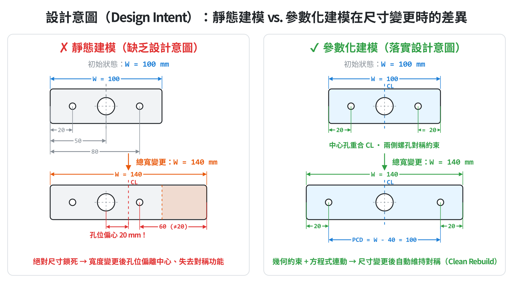
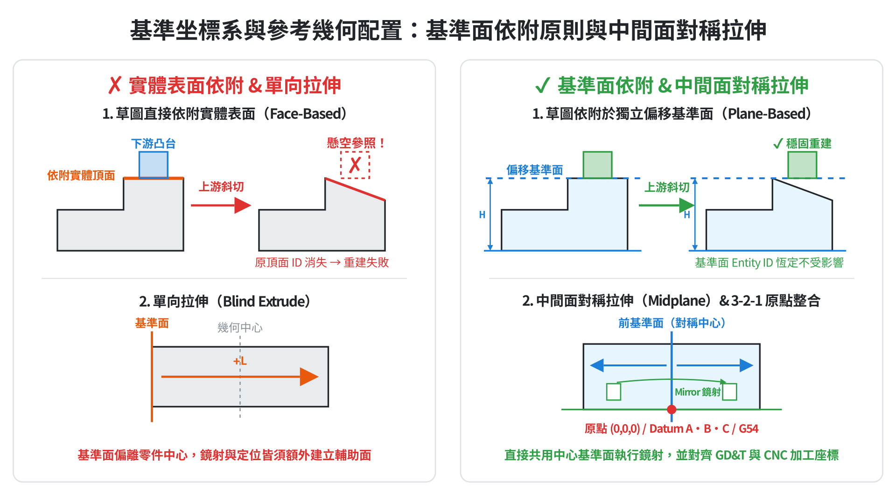
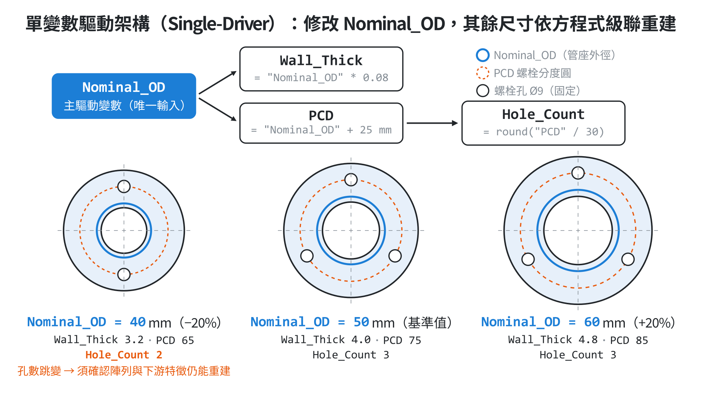
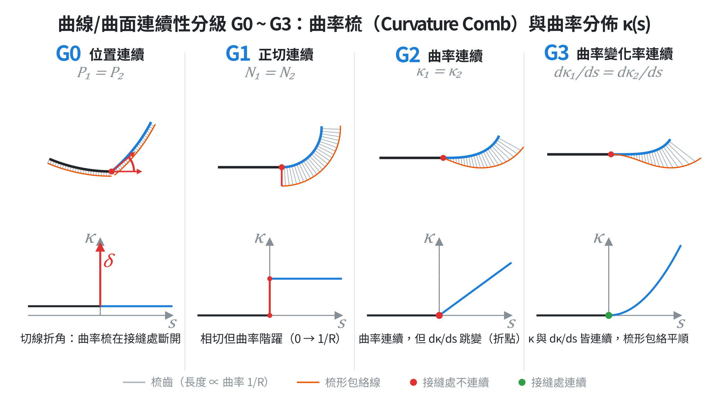
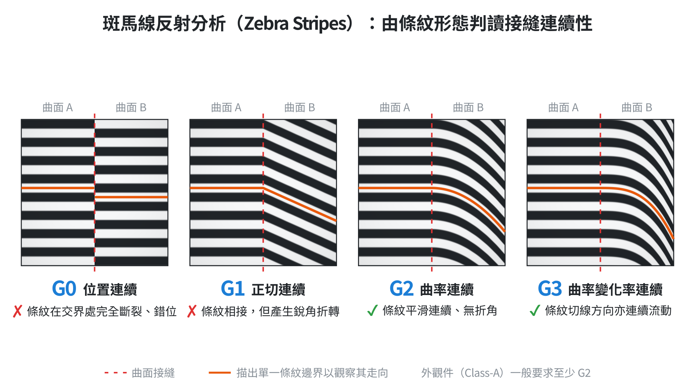
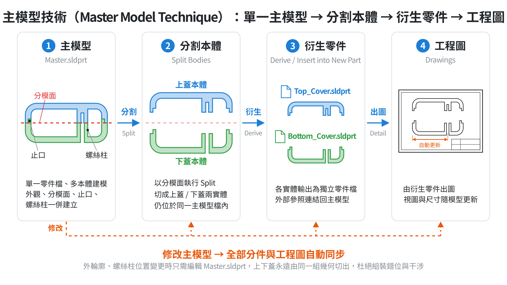
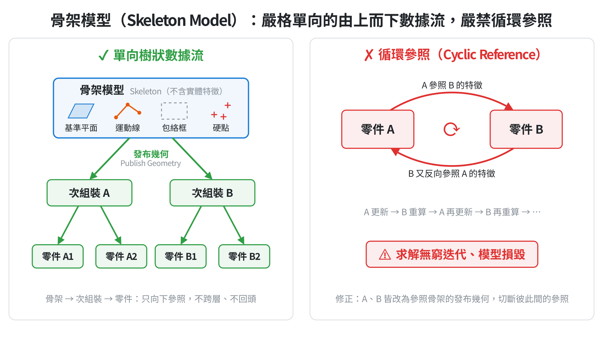
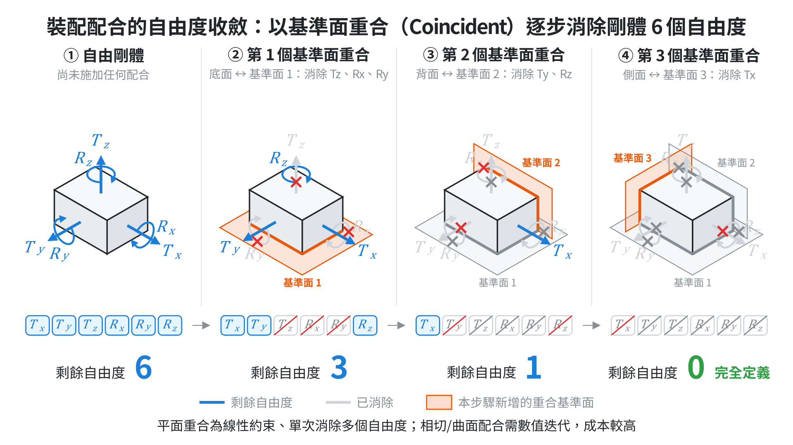
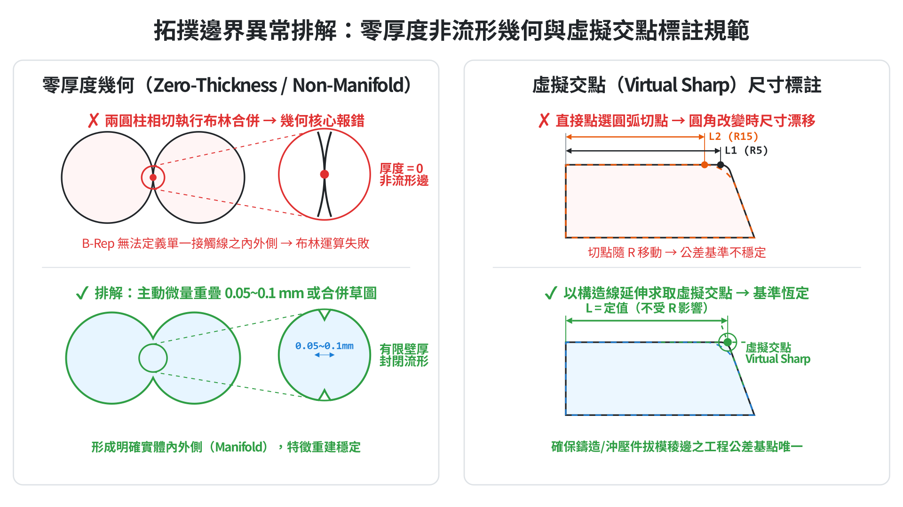

pagetime: 2025/02/01
title: 電腦輔助設計 (CAD) 核心原理與工程建模架構
author: NCKUME Wiki Team

【電腦輔助設計(Computer-Aided Design, CAD)】在現代機械工程與機電產品開發中，是連結工程概念、數理模型、結構分析（CAE）與數控製造（CAM）的核心樞紐。參數化實體與曲面模型本質為一組由幾何約束、尺寸變數、拓撲相依關係構成的**非線性數學規則求解系統**。

本頁面彙整業界資深機械工程師之建模實戰經驗，深入探討主流軟體定位、設計意圖落實、基準坐標架構、曲面連續性（G0~G3）、多本體主模型技術（Master Model Technique）、大型裝配體管理與避免拓撲崩潰之進階規範。

---

## 1. 常見 CAD 軟體特性比較 (Comparison of Major CAD Software)

大專院校教學普及度與產業界實務應用中，不同 CAD 系統依其定位、幾何核心（Geometric Modeling Kernel）與下游製造（CAM）模組呈現嚴密之對應結構。以下依教學常見程度與業界泛用頻率排列，並標註對應之 CAM 製造生態：

| 軟體名稱 | 開發商 | 幾何核心 | 架構型態 | 對應/原生 CAM 模組 | 主要應用領域與技術特點 |
| :--- | :--- | :--- | :--- | :--- | :--- |
| **SolidWorks** | Dassault Systèmes | Parasolid | 本地桌面 | 深度嵌入式 SolidCAM、CAMWorks | 大專院校工程圖學與機構設計教學普及度最高；廣泛應用於自動化機械、機構夾治具、消費性產品與鈑金銲件，市佔率高且生態系完整。 |
| **Siemens NX** | Siemens Digital Industries | Parasolid (原生) | 本地桌面 / 混合雲 | 原生完全整合 Siemens NX CAM | 大專院校進階 CAD/CAM、模具設計與數控加工常用；為航太發動機、汽車傳動、精密模具與十萬件以上超大型裝配體之工業標準，支援同步建模技術。 |
| **PTC Creo** (原 Pro/E) | PTC | Granite | 本地桌面 | 原生完全整合 Creo Manufacturing | 參數化特徵建模先驅，大專院校進階機構設計教材常客；廣泛應用於消費電子（筆電/通訊代工）、重型機械，以嚴謹之頂層骨架模型（Top-down Skeleton）著稱。 |
| **Autodesk Inventor** | Autodesk | ShapeManager | 本地桌面 | 內建 Inventor CAM (HSM 核心) | 工科院校與技職體系常見教學軟體；廣泛應用於專用機械、產線設備機構與鋼結構，與 AutoCAD (DWG) 格式及 Factory Design 深度相容。 |
| **Autodesk Fusion 360** | Autodesk | ShapeManager | 雲端混合 | 原生內建 Fusion 360 CAM | 近年於大專專題實作、創客打樣與小型加工廠普及迅速；整合 CAD/CAM/CAE 流程、生成式設計（Generative Design），授權形式靈活。 |
| **CATIA** | Dassault Systèmes | CGM | 本地桌面 / 雲端平台 | 原生整合 CATIA Machining (DELMIA) | 多見於特定航太與車輛研究所或產學專案；在民航機體（波音/空巴）、汽車外觀 A 級曲面（Class-A Surfacing，G3/G4 連續性）與大型複雜系統工程居壟斷地位。 |
| **Onshape** | PTC | Parasolid (雲端叢集) | 雲端原生 (瀏覽器) | 雲端外掛 (CloudCAM / CAMWorks) | 免安裝跨平台雲端 CAD，於跨校競賽與學生專題採用率上升；具備內建版本控制（分支與合併 Branch & Merge），支援多人即時同文檔協同設計。 |
| **FreeCAD** | 開源社群 (LGPL) | OpenCASCADE (OCCT) | 本地跨平台 | 原生內建 Path / CAM 工作台 | 開源硬體社群與免授權研究環境採用；全模組支援 Python 腳本驅動，具備可自定義擴充之工作台架構。 |

* **幾何核心之關聯**：CAD 軟體的公差解析度、布林運算穩定度與檔案互通性取決於底層幾何核心。例如採用相同 Parasolid 核心之軟體（如 SolidWorks、NX、Onshape），在交換 Parasolid 原生檔（`.x_t`, `.x_b`）或 STEP 檔時，幾何破面與拓撲轉換錯誤率顯著低於跨核心轉譯。
* **CAD 與 CAM 整合協同性**：
  * **一體化/嵌入式系統**（如 NX CAM、SolidCAM、Creo Manufacturing、Fusion 360 CAM）：幾何模型與刀具路徑共享同一幾何資料庫。當 CAD 實體特徵尺寸變更時，CAM 刀具軌跡可直接觸發關聯式重建（Associative Regeneration），消除重複設定加工特徵之時間。
  * **獨立專用 CAM 系統**（如 Mastercam、PowerMill、HyperMILL）：詳見 [電腦輔助製造 (CAM) 核心原理](file:///C:/projects/NCKUME-wiki/docs/computer-aided/CAM.md)，加工廠主要透過 Parasolid 或 STEP AP242 中性幾何標準讀入模型進行跨平台刀軌演算。

---

## 2. 設計意圖 (Design Intent) 與參數化邏輯

設計意圖指在建立幾何模型時預先定義特徵之間的約束與相依關係，使模型在主要尺寸變更時仍能維持正確的幾何形態與工程功能。

* **靜態建模 vs. 參數化建模**：
  * **靜態建模**：僅滿足特定數值的幾何外觀，缺乏特徵之間的因果關聯。當輸入參數變更時，容易產生幾何拓撲錯誤或相依特徵失效。
  * **參數化建模**：將工程規則轉化為幾何約束與方程式（例如：軸承孔中心恆定位於安裝面中心線、螺孔分度圓直徑隨軸徑連動），確保尺寸變更後能自動完成一致性重建（Rebuild）。
* **檢驗標準**：核心尺寸變更時，模型能維持特徵樹無警告與無錯誤重建（Clean Rebuild），且拓撲關係不變形。



---

## 3. 基準坐標系與參考幾何配置 (Datum Strategy)

在參數化特徵建模中，基準面（Datum Plane）與基準軸（Datum Axis）具有系統內部穩定的識別碼（Entity ID），而實體表面與邊緣則會隨布林運算與特徵修改而變更。

### 基準面依附原則 (Plane-Based Referencing)
* **實體表面參照之限制**：若直接以零件之實體表面作為草圖基準，當上游特徵變更導致該表面被切除、分割或邊界改變時，下游草圖與特徵將失去依附對象，產生懸空參照（Dangling References）。
* **建模規範**：主要草圖應優先依附於預設基準面（前基準面、上基準面、右基準面）或以尺寸明確定義之偏移基準面，避免依附於易受修改影響之實體表面。

### 對稱拉伸配置 (Midplane Extrusion)
* 基礎實體特徵（Base Feature）應優先採用中間面對稱拉伸（Midplane Extrude），使原始基準面維持於零件幾何對稱中心。
* 此配置可直接利用初始基準面執行後續之鏡射（Mirror）、中心定位孔與裝配對稱對齊，無須重複建立輔助基準面。

### 原點與 3-2-1 製造定位基準整合
* 模型空間原點 $(0, 0, 0)$ 應對齊幾何對稱中心、旋轉軸心，或實體製造檢驗之第一基準（Datum A, B, C 之交會點）。
* 原點對齊製造基準有助於工程圖幾何公差（GD&T）標註及 CNC 加工座標系（G54）之設定。



---

## 4. 單變數與方程式驅動架構 (Single-Driver Architecture)

系列化零件或需頻繁調整的幾何模型，應將關鍵尺寸收斂為單一或少數主驅動變數（Master Driver），其餘相依特徵透過幾何約束或方程式進行級聯計算。

### 全域變數與相依方程式表
於參數表中設定主變數，次要特徵尺寸以數學關係式表示：

| 參數名稱 | 關係式範例 | 說明 |
| :--- | :--- | :--- |
| `Nominal_OD` | `50 mm` | **主驅動變數**：公稱外徑或主要跨距 |
| `Wall_Thick` | `= "Nominal_OD" * 0.08` | 壁厚隨尺寸等比縮放，維持結構剛度 |
| `PCD` | `= "Nominal_OD" + 25 mm` | 螺栓分度圓直徑自動外推，確保安裝間隙 |
| `Hole_Count` | `= round("PCD" / 30)` | 孔數隨節圓直徑自動調整，維持間距均勻 |



---

## 5. 進階曲面連續性理論 (Surface Continuity & Evaluation)

在工業產品設計、流體外型與模具設計中，曲面接縫過渡的平滑度直接決定外觀反射品質、空氣力學流場與加工刀具軌跡的加速度連續性。

### 曲面連續性幾何分級 ($G0 \sim G3$)

| 連續性等級 | 數學定義 | 物理幾何表現 | 斑馬線 (Zebra Stripes) 檢測 | 典型工程應用 |
| :--- | :--- | :--- | :--- | :--- |
| **$G0$** (位置連續) | 邊界點座標重合：$P_1(u) = P_2(u)$ | 兩曲面相交，接觸處存在明顯折角或稜線。 | 條紋在交界處**完全斷裂**、錯位。 | 一般機構內構件、底面接觸面。 |
| **$G1$** (正切連續) | 邊界法向量共線（一階導數方向相同）：$N_1(u) = N_2(u)$ | 曲面接觸處相切平滑，無折角，但曲率半徑突變。 | 條紋在交界處**相接但產生銳角折轉**。 | 一般倒角（Fillet）、無外觀要求的過渡面。 |
| **$G2$** (曲率連續) | 邊界法向與曲率中心相同（二階導數連續）：$\kappa_1(u) = \kappa_2(u)$ | 曲面過渡處曲率值完全相等，無曲率階躍突變。 | 條紋在交界處**平滑連續無折角過渡**。 | 汽車外裝板件（Class-A）、消費電子產品外殼。 |
| **$G3$** (曲率變化率連續) | 曲率之一階導數連續（三階導數連續）：$\frac{d\kappa_1}{ds} = \frac{d\kappa_2}{ds}$ | 曲率變化加速度平順，消除任何光影扭曲。 | 條紋不僅連續，其**切線方向亦呈現連續流動**。 | 高階超跑外觀、高階光學鏡面反射罩。 |

### 曲面品質檢驗工具
1. **斑馬線反射分析 (Zebra Stripes)**：在模型表面投射虛擬平行條紋光源，藉由反射條紋的連續度直觀判斷 $G0$（中斷）、$G1$（折角）或 $G2$（平順）。
2. **曲率梳 (Curvature Comb)**：沿曲線或曲面母線繪製曲率法向線段，線段長度代表曲率大小（$1/R$）。若曲率梳包絡線無斷階，即滿足曲率連續。





---

## 6. 主模型技術 (Master Model Technique) 與由上而下骨架架構

在多機構零組件（如筆記型電腦上下蓋、手持儀器外殼）協同設計中，最常發生的問題是公母卡榫、螺絲柱與外輪廓在各自獨立繪製時產生尺寸錯位。

### A. 主模型技術 (Master Model Technique, MMT)
1. **單一主零件檔建模**：在單一 CAD 零件檔內，先將上下外殼的完整外觀、分模面（Parting Surface）、公母止口（Lip & Groove）與核心安裝定位特徵一併建立為多本體（Multi-Body Solid）。
2. **布林運算分割本體**：利用分模面執行分割（Split），切分為「上蓋實體」與「下蓋實體」。
3. **特徵衍生派生 (Derive / Insert into New Part)**：將各實體分別衍生輸出為獨立的零件檔案（Top_Cover.sldprt, Bottom_Cover.sldprt）。
4. **連動效益**：當外觀輪廓或安裝柱位置變更時，僅需修改主模型檔，所有分件之零件檔與工程圖將自動同步更新，杜絕組裝干涉。



### B. 骨架模型 (Skeleton Model) 與單向數據流
* **骨架內容**：只包含基準平面、核心運動線、空間包絡輪廓（Bounding Box）與關鍵硬點（Hard Points），不包含實體特徵。
* **發布幾何原則 (Publish Geometry)**：各子系統零件僅能透過複製骨架模型之參考幾何生成實體。
* **嚴禁循環參照 (No Cyclic Reference Loops)**：零件 A 參照零件 B，零件 B 又反向參照零件 A 的特徵，會導致求解矩陣產生無窮迭代與模型損毀。數據流必須為嚴格的單向樹狀分支（骨架 $\to$ 次組裝 $\to$ 零件）。



---

## 7. 大型裝配體效能架構與管理 (Large Assembly Performance)

當裝配體零件數量達到數千至數萬件時，CAD 求解器計算負荷呈指數上升，常見症狀為檔案開啟緩慢、旋轉卡頓與重建崩潰。

### A. 裝配配合 (Mates) 的自由度收斂原則
* 每個空間剛體具有 6 個自由度（3 平移 + 3 旋轉）。
* **基準面配合優先**：優先使用主要基準面（Top/Front/Right）的重合（Coincident）約束，單一配合即可同時消除多個自由度。
* **避免過度依賴非線性約束**：相切（Tangent）與曲面配合需要數值迭代解算，計算資源消耗遠大於平面重合。
* **次裝配體模組化 (Sub-assembly)**：將相關零件歸納於次裝配體中，避免在頂層總裝配體中存在數百個頂層零件，使求解器每次僅需求解局部約束矩陣。



### B. 輕量化模式與特徵抑制 (Defeature & Lightweight)
* **輕量化載入 (Lightweight Mode)**：僅載入零件的幾何顯示網格（Graphics Triangles），不載入底層特徵樹，使大型檔案開啟時間縮短 80% 以上。
* **簡化包絡體 (Envelope / SpeedPak)**：對於購買標準件（如馬達、減速機、氣壓缸），去除內部齒輪、線圈與螺栓細節，以簡化實體取代，大幅釋放顯示記憶體。

---

## 8. 拓撲邊界異常排解 (Boolean Topology & Non-Manifold Errors)

### 零厚度幾何 (Zero-Thickness Geometry)
* **成因**：當兩個實體在圓柱相切線或尖銳頂點處執行布林加法（Union / Merge）時，接觸區產生一條在空間中厚度為零的幾何邊線或點（Non-Manifold Edge/Vertex）。邊界表示法（B-Rep）無法定義該邊線之實體內外側，導致幾何核心報錯。
* **工程排解方案**：
  * **主動微量重疊**：使相切特徵微量穿透（Over-penetration，例如深入 $0.05 \sim 0.1\text{ mm}$）後再執行布林合併。
  * **合併草圖輪廓**：避免分次拉伸相切實體，改在單一草圖中以封閉幾何一次拉伸成型。

### 虛擬交點 (Virtual Sharps)
* 在設計鑄造件或沖壓件時，稜邊多半帶有拔模斜度與圓角。標註尺寸時若直接點選圓弧切線，當圓角半徑變更時，尺寸值會漂移。
* **規範**：利用兩條非平行直線的構造線相交產生「虛擬交點（Virtual Sharp）」，尺寸標註必須定錨於虛擬交點上，確保工程公差基點之唯一性。



---

## 9. 特徵樹的層級劃分與建置順序 (Resilient Modeling Strategy)

特徵樹必須嚴格遵守「由大到小、由粗到細」的層級秩序，避免父子依賴混亂：

```
[第 1 階: 參考幾何]  基準面、軸線、主變數與骨架草圖 (Datums & Skeletons)
        ↓
[第 2 階: 核心實體]  基底拉伸或旋轉，建立主要包絡體積 (Base Solids)
        ↓
[第 3 階: 功能幾何]  安裝槽、通孔、加強肋與結構掏空 (Functional Features)
        ↓
[第 4 階: 製程特徵]  拔模斜度、密封槽與局部退刀槽 (Manufacturing Details)
        ↓
[第 5 階: 修飾幾何]  邊緣圓角（Fillet）與倒角（Chamfer）
```

???+ note "圓角與倒角的排序原則"
    非結構性（消除銳角或外觀修飾用）之圓角與倒角應置於特徵樹末端。若過早建立圓角，後續草圖可能錯誤捕捉圓弧切線或過渡曲面；當主尺寸變更導致曲面拓撲改變時，將使下游特徵之幾何參照中斷。

---

## 10. 草圖約束規範 (Sketch Constraints)

* **幾何約束優先於尺寸標註**：幾何關係（如平行、垂直、共線、相切、對稱、相等）應優先於數值尺寸。相同尺寸之多個幾何圖元應施加「相等（Equal）」約束，而非重複標註數值。
* **約束建立順序**：
  1. 錨定圖元至原點或基準線。
  2. 施加相對幾何約束（平行、垂直、對稱）。
  3. 標註關鍵驅動尺寸。
* **禁止使用任意固定約束（Fix / Ground Constraint）**：「固定」約束缺乏明確幾何因果關聯，在尺寸參數變更時易導致過度約束（Over-constrained）或無解衝突。
* **完全定義要求（Fully Defined）**：草圖必須完全約束（各 CAD 系統中通常顯示為黑色線段），不得留有未定義之自由度。

---

## 11. 實務規範與反模式 (Best Practices & Anti-patterns)

* **螺紋表現方式**：除特定 3D 列印或定製非標螺牙外，一般標準螺紋禁止使用螺旋掃出切削實體牙型。實體螺旋幾何會顯著增加檔案容量並降低裝配體重建效能；應採用「孔精靈（Hole Wizard）」並附加「裝飾螺紋線（Cosmetic Thread）」以利工程圖自動引出規範標註。
* **特徵語意化命名**：預設特徵名稱（如 `Boss-Extrude1`）應依工程機能重新命名（如 `Base_Housing`, `Mounting_Pockets`, `O_Ring_Groove`），並將次要特徵歸納於資料夾中。
* **參數彈性檢驗（Flex Testing）**：於模型定稿前，將核心主變數進行 $\pm 20\%$ 之數值變更測試，驗證特徵樹於極值條件下之重建穩定度，確認無拓撲反轉或幾何穿透。
* **製造工藝對接**：詳細切削、射出、鈑金與 3D 列印之邊界限制，參見 [為製造而設計 (DFM)](../design/dfm.md)。

---

## 12. 延伸閱讀與跨領域對接

* [電腦輔助製造 (CAM) 核心原理](file:///C:/projects/NCKUME-wiki/docs/computer-aided/CAM.md)：CNC 數控工具機加工座標系、刀具路徑演算法與切削物理。
* [3D 建模幾何典範與專用軟體架構](file:///C:/projects/NCKUME-wiki/docs/computer-aided/modeling.md)：實體 B-Rep、NURBS 自由曲面與多邊形網格（SubD）幾何典範比較。
* [為製造而設計 (DFM)](file:///C:/projects/NCKUME-wiki/docs/design/dfm.md)：機械切削、注塑成型與鈑金加工之尺寸與幾何設計限制。
