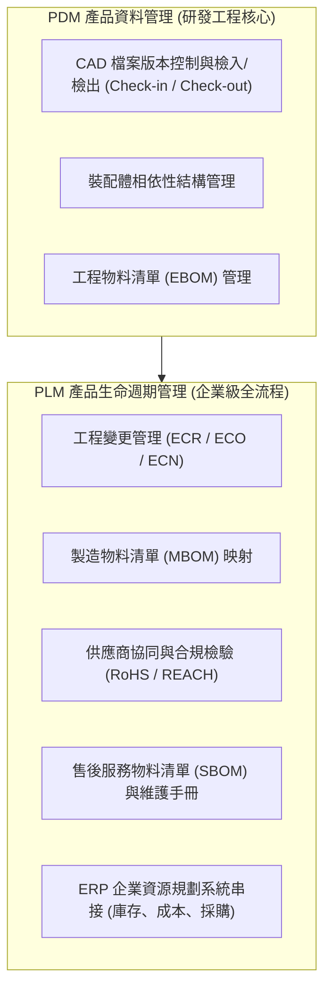
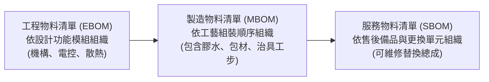
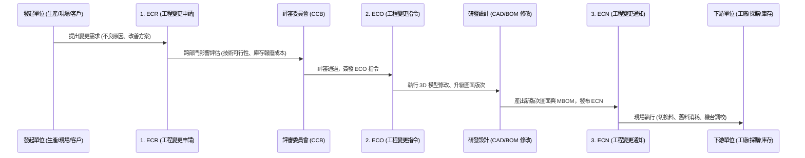

pagetime: 2025/02/01
title: 產品生命週期管理 (PLM) 與工程資料管理架構
author: NCKUME Wiki Team

【產品生命週期管理 (Product Lifecycle Management, PLM)】是一種整合資訊系統與商業策略的框架，負責管理產品從概念發想、詳細設計（CAD）、工程分析（CAE）、製程規劃（CAM）、製造生產、售後維修到最終報廢回收的整體生命週期資料。

在現代機械工程與機電一體化系統中，PLM 解決了跨部門協同中常見的版本混亂、工程變更失控與物料清單（BOM）不一致等結構性問題。

---

## 1. PDM 與 PLM 系統架構分工

| 系統維度 | 產品資料管理 (PDM, Product Data Management) | 產品生命週期管理 (PLM, Product Lifecycle Management) |
| :--- | :--- | :--- |
| **主要使用者** | 機械設計工程師、CAD 繪圖員、研發主管。 | 研發、製程、採購、品保、售後服務與供應鏈管理團隊。 |
| **管理核心** | CAD 原生圖檔、裝配外部參照、圖層、修訂版本。 | 零件生命週期狀態、工程變更流程、多視圖 BOM、跨系統整合。 |
| **典型功能** | 檔案檔案鎖定（防止覆寫）、特徵相依性解析、輕量化 3D 預覽。 | 跨組織變更審批簽核、法規合規性追蹤、ERP/MES 數據雙向同步。 |

---

## 2. 物料清單結構轉換 (BOM Evolution)

在不同產品生命週期階段，物料清單依其功能需求呈現不同視圖：

1. **工程物料清單 (EBOM, Engineering BOM)**：
   * 由 CAD 裝配體結構自動提取生成。
   * 反映產品的「設計與功能邏輯」（例如：外殼總成、主驅動總成、光學感測模組）。
   * 不包含製造輔料（如螺絲防鬆膠、導熱膏、包裝緩衝材）。
2. **製造物料清單 (MBOM, Manufacturing BOM)**：
   * 反映實際車間「裝配順序與製程路線（Routing）」。
   * 加入非幾何輔料（消耗品、潤滑脂）、外包半成品編號及工裝治具指派。
   * 階層依流水線工位拆解，而非純依機械機能劃分。
3. **服務物料清單 (SBOM, Service BOM)**：
   * 針對售後維修與現場更換單元（Line Replaceable Unit, LRU）設計。
   * 將無法單獨拆解更換的子零件打包為維修套件（Kit）。

---

## 3. 工程變更控制流程 (Engineering Change Management)

未經嚴格流程控制的設計變更，是製造現場產生呆料、報廢或裝配干涉的主因。標準 PLM 工程變更遵循三階閉環：

1. **工程變更申請 (ECR, Engineering Change Request)**：
   * 任何單位（如生產線反饋孔徑公差過緊導致裝配不良）皆可提出。
   * 說明問題現象、建議改善方案與預期效益。
2. **變更控制委員會評審 (CCB, Change Control Board)**：
   * 由研發、製造、採購、品保共同評審。
   * 關鍵審查項目：在製品（WIP）處理方式、在庫舊品是否需要報廢、模具修改成本、供應商交期衝擊。
3. **工程變更指令 (ECO, Engineering Change Order)**：
   * 經審批確認執行後，系統鎖定舊版 CAD 圖面與 BOM。
   * 研發單位依 ECO 編號建立新版本檔案（如 Rev A $\to$ Rev B），更新幾何與尺寸。
4. **工程變更通知 (ECN, Engineering Change Notice)**：
   * 設計修改完成並通過驗證後，正式對全企業發布通知。
   * 載明變更生效日期、批次序號（Serial Number cutoff）及舊料消耗過渡策略。

---

## 4. 主流 PLM 軟體平台

| 軟體名稱 | 開發商 | 核心特點與市場定位 |
| :--- | :--- | :--- |
| **Siemens Teamcenter** | Siemens Digital Industries | 全球大型工業市佔率最高系統之一；航太、汽車、大型機械標準平台，與 NX 及多 CAD 深度整合。 |
| **Dassault 3DEXPERIENCE (ENOVIA)** | Dassault Systèmes | 整合 CATIA、SolidWorks 與 SIMULIA；支援單一資料源（Single Source of Truth）與全虛擬雙生管理。 |
| **PTC Windchill** | PTC | 純 Web 架構 PLM 先驅；與 Creo 緊密整合，具備強大之多 CAD 管理、物聯網（ThingWorx）數據對接能力。 |
| **Autodesk Vault** | Autodesk | 專注於中小型機械設備與加工業；與 Inventor、AutoCAD 深度整合，架設與維護成本較低。 |
| **Aras Innovator** | Aras Corp | 開放原始碼授權模式企業級 PLM；具備高客製化彈性，適合具備軟體開發能力之特殊製造業。 |

---

## 5. 延伸閱讀

* [電腦輔助設計 (CAD) 核心原理](file:///C:/projects/NCKUME-wiki/docs/computer-aided/CAD.md)：特徵建模、設計意圖與大型裝配體管理。
* [電腦輔助製造 (CAM) 核心原理](file:///C:/projects/NCKUME-wiki/docs/computer-aided/CAM.md)：數控加工工藝規劃與代碼生成。
* [為製造而設計 (DFM)](file:///C:/projects/NCKUME-wiki/docs/design/dfm.md)：減少工程變更頻率的前端製造性考量。
