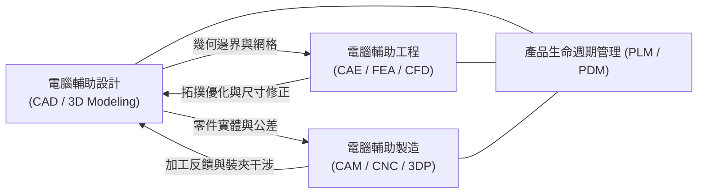

pagetime: 2025/02/01
title: 電腦輔助技術 (CAx) 導論
author: NCKUME Wiki Team

【電腦輔助技術 (Computer-Aided Technologies, CAx)】是現代機械工程、航太與製造工業的數位化骨幹。CAx 涵蓋從產品概念造型、結構與物理場數值模擬、數控製造加工，到產品生命週期數據管理的完整閉環。

---

## 1. CAx 核心領域分工

| 領域 | 全稱 | 核心功能 | 主要輸出物 |
| :--- | :--- | :--- | :--- |
| **CAD** | Computer-Aided Design | 建立精確幾何形體、定義裝配約束、尺寸驅動與工程圖出圖。 | 3D 實體模型（STEP、Parasolid）、2D 工程圖面（DWG、PDF）。 |
| **3D Modeling** | 3D 建模與自由曲面 | 自由外觀造型、高階 NURBS 曲面（Class-A）、多邊形細分與人體工學雕刻。 | NURBS 曲面（.3dm）、高密度網格（.obj、.stl）、渲染視覺化圖形。 |
| **CAE** | Computer-Aided Engineering | 有限元素分析（FEA）、計算流體力學（CFD）、多體動力學（MBD）數值模擬。 | 應力應變場雲圖、安全係數、模態振形、流阻與熱耗散曲線。 |
| **CAM** | Computer-Aided Manufacturing | 規劃工具機刀具切削路徑、設定工件座標系、後處理產出加工程式碼。 | 數控機台程式碼（G-Code / M-Code）、刀具清單與工裝報表。 |
| **PLM** | Product Lifecycle Management | 控管物料清單（BOM）、工程變更（ECO/ECN）、版本版本回溯與供應鏈協同。 | 統整版次之 Engineering BOM、數位雙生模型、變更審批紀錄。 |

---

## 2. 模組導覽

* [電腦輔助設計 (CAD) 核心原理](file:///C:/projects/NCKUME-wiki/docs/computer-aided/CAD.md)：深入探討 SolidWorks, NX, Creo 等軟體定位、設計意圖、基準面架構、曲面連續性（G0~G3）、多本體主模型技術（MMT）與大型裝配體效能優化。
* [電腦輔助製造 (CAM) 核心原理](file:///C:/projects/NCKUME-wiki/docs/computer-aided/CAM.md)：解析 NX CAM, Mastercam 等工具之 WCS 坐標系配置、切削物理力學公式（切削速度、進給、MRR、殘留高度）、擺線高速粗銑、多軸同動與 G 代碼標準。
* [3D 建模幾何典範與專用軟體架構](file:///C:/projects/NCKUME-wiki/docs/computer-aided/modeling.md)：對比實體 B-Rep、NURBS 曲面與多邊形網格（SubD）三大幾何表徵，深入探討 Rhino（NURBS/Grasshopper 參數化演算法）與 Blender（多邊形拓撲、細分曲面與 PBR 渲染）。
* [產品生命週期管理 (PLM)](file:///C:/projects/NCKUME-wiki/docs/computer-aided/PLM.md)：工程變更流程（ECR/ECO）、物料清單（EBOM/MBOM）與跨部門協同資料管理。
