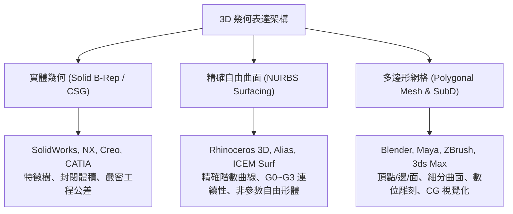
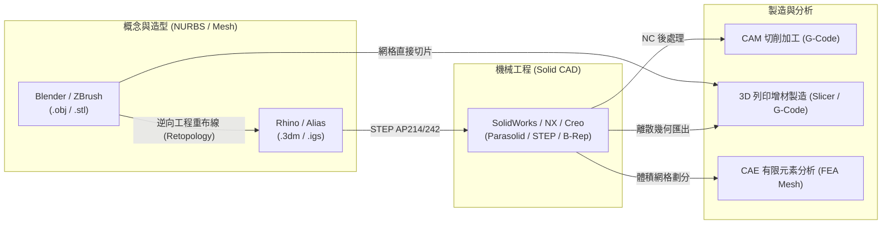

pagetime: 2025/02/01
title: 3D 建模幾何典範與專用軟體架構
author: NCKUME Wiki Team

【3D 建模 (3D Modeling)】在現代機械工程、工業設計與數位製造領域中，涵蓋了參數化實體建模、高階自由曲面造型、多邊形離散網格以及程序化演算法生成。不同軟體的底層幾何內核與資料結構決定了其空間解析精度、拓撲自由度與適用之製造工藝。

本頁面彙整非傳統機械 CAD 範疇的主流 3D 建模軟體體系，對比三大核心幾何典範（實體 B-Rep、NURBS 曲面、多邊形網格 SubD），深入探討 Rhinoceros 3D（含 Grasshopper 參數化演算法）與 Blender（多邊形拓撲、細分曲面與工程視覺化）之數理基礎與工業應用。

---

## 1. 三大核心 3D 幾何表達典範 (Core 3D Representations)

3D 模型在計算機記憶體中的表徵方式，主要分為三種數學架構：

| 幾何表達形式 | 數學底層與結構 | 優點 | 限制與缺點 | 主要應用領域 |
| :--- | :--- | :--- | :--- | :--- |
| **邊界表示法 (B-Rep) / 實體** | 解析幾何面（平面、柱面、錐面）結合剪裁曲面，以頂點、邊、迴路（Loop）定義封閉流形體積。 | 具備完整質量物理屬性（體積、重心、慣性矩），支援公差標註、工程出圖與 CAE 網格劃分。 | 拓撲結構剛硬，難以直觀揉捏高階有機造形；複雜變形易導致特徵樹歷史重建失敗。 | 機械機構件、模具注塑、夾治具、車銑切削零件。 |
| **NURBS 自由曲面** | 非均勻有理 B 樣條（Non-Uniform Rational B-Splines），由階數 $p$、控制點權重與節點向量精確計算。 | 支援極高平滑度（$G2$ / $G3$ 連續），數學解析精度極高，檔案體積小且支援自由形體控制。 | 無歷史樹回溯（或較弱），多曲面拼貼修剪邊界縫合需高度經驗，破面公差較敏感。 | 產品工業外觀設計（ID）、汽車外裝板件、造船遊艇外殼、建築自由曲面。 |
| **多邊形網格 (Polygonal Mesh / SubD)** | 由空間離散頂點（Vertices）、直線邊（Edges）與平面多邊形（Faces，主要是四邊形與三角形）構成。 | 幾何拓撲極具彈性，支援上千萬面級數位雕刻與有機人因曲面，直接對接遊戲引擎與渲染器。 | 僅為近似離散面，無解析曲率；面數直接影響記憶體，難以直接進行傳統數控車銑軌跡計算。 | 人體工學握把打樣、生物醫療植入物、動畫與遊戲模型、產品渲染與廣告動畫。 |

---

## 2. 主流 3D 建模與周邊軟體定位矩陣

依據設計自由度、工程精度要求與主要功能劃分：

| 軟體名稱 | 開發商 | 主要幾何類型 | 建模典範 | 核心定位與工業應用場景 |
| :--- | :--- | :--- | :--- | :--- |
| **Rhinoceros 3D (Rhino)** | Robert McNeel & Associates | NURBS / SubD / Mesh | 顯式直接幾何 + 演算法 (Grasshopper) | 工業外觀設計、珠寶金工、船舶造船、建築外觀；透過 Grasshopper 支援生成式幾何與輕量化點陣設計。 |
| **Blender** | Blender Foundation (開源) | 多邊形網格 (Polygonal Mesh) / SubD | 數位雕刻 + 多邊形細分 + 節點驅動 | 開源多功能 3D 套裝；支援人因工學外殼數位打樣、拓撲重構、Cycles/EEVEE 物理擬真渲染與產品動態分解動畫。 |
| **Autodesk Alias** | Autodesk | 高階 NURBS / Class-A | 顯式曲面動態造型 | 全球汽車產業造型設計與外裝 A 級曲面標準；具備極致的曲率梳調整工具與光影高光反射控制。 |
| **Pixologic ZBrush** | Maxon | 稠密多邊形網格 (Dense Mesh) | 數位黏土雕刻 (Digital Sculpting) | 百萬至千萬級面數極致細節雕刻；用於人體工學客製化握持面、醫療義肢適形外殼與有機紋理生成。 |
| **SideFX Houdini** | SideFX | 程序化幾何節點 (Procedural VEX) | 演算法節點流 (Node Graph) | 程序化幾何生成極致工具；用於自動化點陣結構、流體外觀模擬、大規模結構變異衍生設計。 |
| **KeyShot / Substance 3D** | Luxion / Adobe | 渲染與材質紋理 (PBR Texturing) | 物理光跡追蹤 / UV 貼圖 | 接收 CAD 與網格模型，指派物理光學材質（金屬拉絲、光學散射、注塑咬花），產出量產決策效果圖。 |

---

## 3. Rhinoceros 3D 與 NURBS 幾何數學基礎

【Rhinoceros 3D (Rhino)】採用顯式幾何控制（Explicit Geometry Control），允許設計者直接透過曲線階數、控制點網格與節點向量進行自由形體的精確形塑。

### A. NURBS 曲線數學定義
一條 $p$ 階（Degree $p$）的 NURBS 曲線 $C(u)$ 定義為控制點 $P_i$ 的有理加權線性組合：

$$
C(u) = \frac{\sum_{i=0}^n N_{i,p}(u) w_i P_i}{\sum_{i=0}^n N_{i,p}(u) w_i}
$$

其中：
* $P_i \in \mathbb{R}^3$：控制點（Control Points）座標，共 $n+1$ 個控制點，構成控制多邊形。
* $w_i \in \mathbb{R}^+$：控制點對應之權重（Weights）。若所有 $w_i = 1$，則退化為標準非有理 B 樣條。
* $N_{i,p}(u)$：第 $i$ 個 $p$ 階 B 樣條基底函數，由 **Cox-de Boor 遞迴公式**定義：

$$
N_{i,0}(u) = \begin{cases} 
1 & \text{若 } u_i \le u < u_{i+1} \\ 
0 & \text{其他} 
\end{cases}
$$

$$
N_{i,p}(u) = \frac{u - u_i}{u_{i+p} - u_i} N_{i,p-1}(u) + \frac{u_{i+p+1} - u}{u_{i+p+1} - u_{i+1}} N_{i+1,p-1}(u)
$$

### B. 節點向量與階數工程選擇
節點向量 $U = \{u_0, u_1, \dots, u_m\}$ 為非遞減實數序列，恆滿足 $m = n + p + 1$。
* **夾緊節點向量 (Clamped)**：首末端點具備重數 $p+1$，使曲線起訖點精確定錨於首末控制點，且端點切線與控制多邊形首末邊共線。
* **階數工程選擇**：
  * **1 階**：多段折線（Polyline）。
  * **2 階**：精確圓錐曲線（圓、橢圓、拋物線、雙曲線）。
  * **3 階**：機械與產品外觀最常用基準曲線，兼顧計算效率與二階導數平滑度。
  * **5 階至 7 階**：高階車體 Class-A 曲面與流線造型首選，具備曲率變化率（$G3$）連續性。

### C. 曲面生成指令與連續性匹配

| 指令 | 運算邏輯 | 工程適用場景 | 拓撲與質量控制要點 |
| :--- | :--- | :--- | :--- |
| **`Loft` (放樣)** | 依序通過多條斷面曲線生成過渡曲面。 | 導流管、機翼斷面、規則過渡管件。 | 各斷面曲線之控制點數量、曲線方向與階數必須一致，避免曲面扭曲。 |
| **`Sweep1` / `Sweep2` (掃掠)** | 沿一或兩條導引軌道移動斷面曲線。 | 把手把持面、密封橡膠條、車體腰線。 | 斷面線端點必須精確吸附於軌道線上，否則邊界產生裂隙。 |
| **`NetworkSrf` (曲面網格)** | 由 $U$ 向與 $V$ 向交叉曲線網絡擬合雙向曲面。 | 複雜非對稱過渡面、封閉頂蓋造型。 | 曲線交會點必須精準相交於公差內；避免建立過密網絡導致曲面過重。 |
| **`Patch` (嵌面)** | 依邊界曲線及點雲進行最小二乘法鬆弛擬合。 | 破損破面修補、非規則邊界填補。 | 為近似演算法，邊緣難以天然達到高階相切，需慎防表面凹陷。 |

* **曲面連續性匹配 (`MatchSrf`)**：
  * **G0 匹配 (位置)**：移動邊界控制點，使兩曲面邊界重合。
  * **G1 匹配 (正切)**：相鄰兩排控制點與公用邊界保持在同一平面共線，強制邊界法向重合。
  * **G2 匹配 (曲率)**：約束前三排控制點之間距比率與方向，使邊界二階導數與曲率半徑完全相符。
* **CAD 導出公差控制**：機械加工零件在 Rhino 中建模時，單位設為公釐（mm），絕對公差必須設為 $0.001\text{ mm}$（$1\ \mu\text{m}$）。輸出前執行 `ShowEdges` 驗證裸露邊緣（Naked Edges）為 0，確保為封閉流形實體（Closed Solid B-Rep）。

---

## 4. Grasshopper 參數化演算法建模

Grasshopper 採用節點式資料流程式設計（Dataflow Programming），以路徑標籤組織階層資料樹（Data Tree，如 `{0;1}[i]`）：
* **`Flatten` (展平)**：消除所有路徑階層，將資料壓縮為單一清單進行全域運算。
* **`Graft` (升維/分枝)**：為列表中每一個元素創建獨立分支，用於一對多矩陣運算。
* **`Simplify` (簡化)**：移除冗餘父層索引，僅保留變動分支維度。

### 工程應用一：TPMS 三週期極小曲面晶格
在積層製造（3D 列印）散熱器與骨科多孔植入物中，TPMS 具備極高比表面積與自生支撐（Self-supporting）特性：
* **Gyroid (螺旋二十四面極小曲面)**：
  $$f(x, y, z) = \sin(kx)\cos(ky) + \sin(ky)\cos(kz) + \sin(kz)\cos(kx) = c$$
* **Schwarz D (Diamond)**：
  $$f(x, y, z) = \cos(kx)\cos(ky)\cos(kz) - \sin(kx)\sin(ky)\sin(kz) = c$$

### 工程應用二：適形表面紋理生成 (`SrfMorph`)
提取目標曲面參數域（$U \in [0, 1], V \in [0, 1]$），將二維平面幾何沿曲面法向量高度場映射，實現雙曲率表面無接縫防滑滾花與流道生成。

---

## 5. Blender 多邊形網格拓撲與工程視覺化

【Blender】以多邊形網格（Polygonal Mesh）為核心，廣泛應用於人體工學曲面雕刻、網格修復、幾何節點程序化生成與 PBR 渲染。

### A. 網格拓撲學規範
1. **四邊面 (Quads)**：每個面精確由 4 個頂點與 4 條邊構成。為工業外觀與外殼建模標準，能明確定義環形環切（Edge Loops），確保細分曲面平滑計算。
2. **三邊面 (Tris)**：結構固定共面，為 GPU 光柵化與 STL 3D 列印底層格式，但在有機彎曲面上容易限制環切走線並形成極點（Poles）。
3. **多邊面 (N-gons, $n \ge 5$)**：僅允許存在於絕對平坦之單一平面；**嚴格禁止**存在於雙曲率受光曲面。

### B. 二維流形實體 (2-Manifold) 檢驗
數控加工與積層製造要求網格具備水密性（Watertight）：
* **共享邊過載 (Edge shared by >2 faces)**：內部隔板錯誤，切片軟體無法判定內外部，需手動刪除內部面。
* **法向反轉 (Inverted Normals)**：相鄰面法向量反向，導致渲染黑色死影或切削刀軌誤判，需全選執行 `Shift + N` 重新計算向外法向。
* **頂點相交 (Non-Manifold Vertex)**：沙漏形接觸點，壁厚為零，需執行布林聯集或分離實體。

### C. Catmull-Clark 細分曲面演算法
每次迭代將四邊面細分為 4 個新四邊形：
* **面點 ($F$)**：面頂點平均值 $F = \frac{1}{n} \sum_{i=1}^n v_i$
* **邊點 ($R$)**：邊端點與相鄰兩面點平均值 $R = \frac{v_1 + v_2 + F_1 + F_2}{4}$
* **新頂點 ($v'$)**：加權平均 $v' = \frac{F + 2R + (k-3)v}{k}$（$k$ 為頂點邊數）
* **倒角半徑控制**：在主邊緣加入**支撐環線 (Support Loops)**，或指派**邊界摺痕權重 (Mean Crease, $0.0 \sim 1.0$)**。

### D. 數位雕刻與人因工程工作流
1. **體素重布線 (Voxel Remesh)**：均勻三維體素場重新採樣，消除自交破面。
2. **人因筆刷雕刻**：利用 Clay Strips、Grab、Inflate 調整指凹槽與握把掌心曲率。
3. **拓撲重構 (Retopology)**：沿應力方向重鋪低面數四邊網格，導入 CAD 執行均勻壁厚抽殼與機構裝配。

### E. 物理擬真渲染 (PBR)
* **Cycles (路徑追蹤)**：計算光子輻射傳遞，用於型錄與廣告之高解析靜態圖。
* **EEVEE (實時光柵化)**：螢幕空間反射（SSR），用於機構分解與裝配動畫渲染。
* **Principled BSDF 材質參數配置**：
  * 金屬零件（陽極氧化鋁）：`Metallic = 1.0`, `Roughness = 0.05 ~ 0.45`。
  * 介電質塑料（ABS/PC）：`Metallic = 0.0`, `Roughness = 0.15 ~ 0.5`, `IOR = 1.46 ~ 1.58`。
  * 半透明材料（POM/矽膠）：`Subsurface = 0.05 ~ 0.2`。

---

## 6. CAD、NURBS 與網格的跨系統資料交換 (Interoperability)

### A. 標準交換格式
* **STEP (`.stp`, `.step`)**：`AP214` 支援裝配與顏色；`AP242` 支援 3D GD&T 與 MBD 語意傳遞。
* **Parasolid (`.x_t`, `.x_b`)**：同核心 CAD（NX、SolidWorks、Onshape）無損交換原生格式。
* **STL (`.stl`) / OBJ (`.obj`)**：離散網格格式，用於 3D 列印與光學掃描。
* **glTF / GLB (`.gltf`, `.glb`)**：具備 PBR 材質之 Web 3D 輕量化交換標準。

### B. 網格轉 CAD (Mesh-to-CAD) 逆向工程
* **自動曲面重構 (Auto-Surfacing)**：演算法鋪設數千塊小 NURBS 面片，面數多且無參數歷史樹，後續難以修改。
* **參數化特徵重建 (Parametric Reverse Engineering)**：手動擷取截面曲線與基準幾何，重繪參數草圖與特徵樹，滿足量產工程變更需求。

---

## 7. 延伸閱讀與跨領域對接

* [電腦輔助設計 (CAD) 核心原理](file:///C:/projects/NCKUME-wiki/docs/computer-aided/CAD.md)：標準機械實體參數化建模、主模型架構與大型裝配體管理。
* [電腦輔助製造 (CAM) 核心原理](file:///C:/projects/NCKUME-wiki/docs/computer-aided/CAM.md)：CNC 數控工具機加工座標系、刀具路徑演算法與切削物理。
* [為製造而設計 (DFM)](file:///C:/projects/NCKUME-wiki/docs/design/dfm.md)：機械切削、注塑成型與鈑金加工之尺寸與幾何設計限制。
